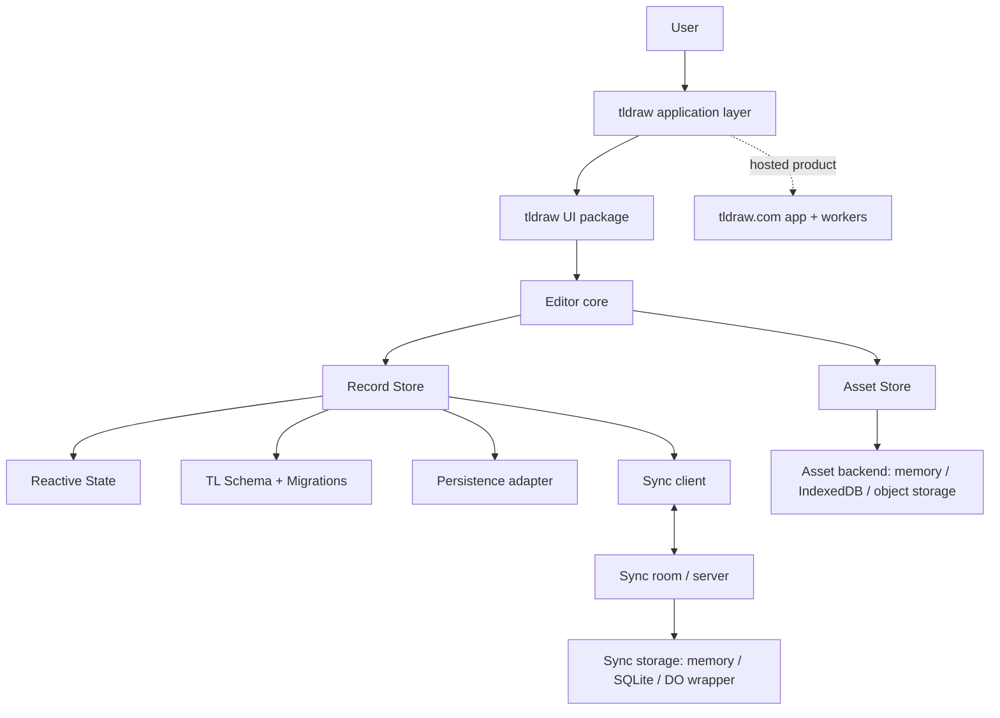
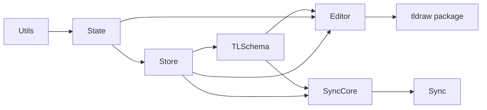
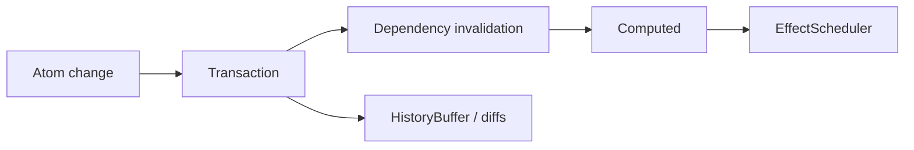
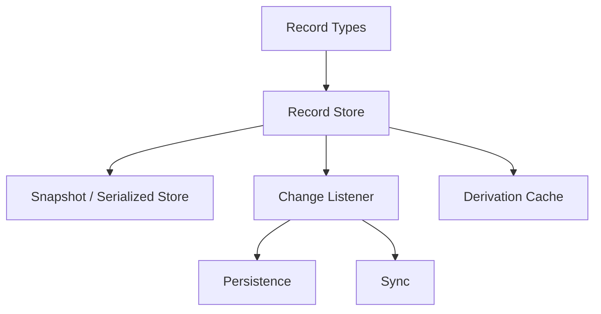
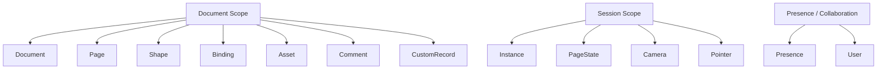
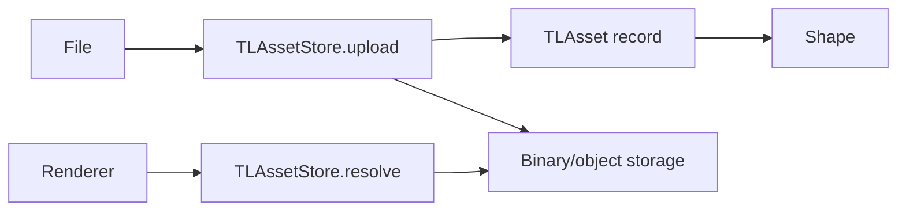
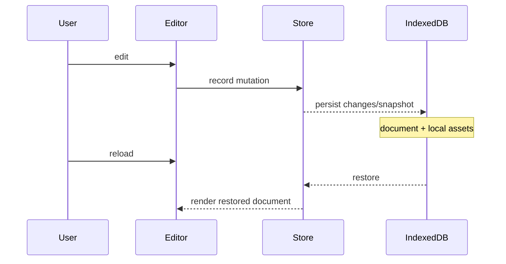
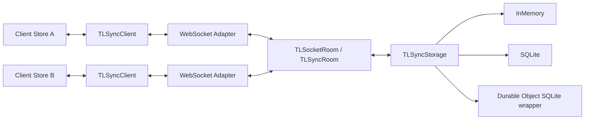
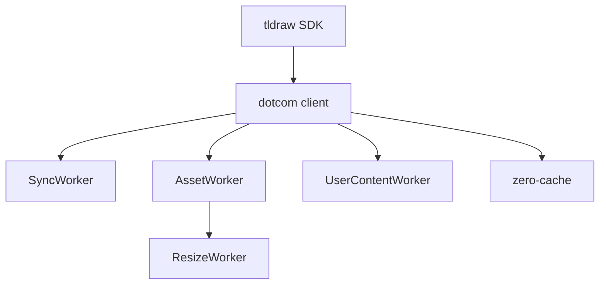

# tldraw — 공개 소스 기반 전체 구조도

검토 기준: 2026-11-08  
정확도: **높음(A1/A2)** — 공식 monorepo, package architecture 문서, SDK 문서 기준.

> 이 문서는 tldraw SDK와 tldraw.com hosted product를 구분한다. 공개 저장소에는 SDK뿐 아니라 dotcom app/worker도 포함되어 있지만, 배포 인프라의 모든 운영 세부가 공개되었다고 가정하지 않는다.

# 1. Product Boundary



핵심: **Editor가 곧 저장소가 아니다.** Editor는 Store 위에서 동작하고, Store는 Reactive State와 Schema를 이용하며, persistence/sync/asset은 별도 경계다.

# 2. Monorepo Topology

공식 monorepo 최상위 구조:

```text
tldraw/
├─ apps/
│  ├─ dotcom/                 hosted tldraw.com product
│  ├─ docs/
│  ├─ examples/
│  ├─ vscode/
│  ├─ analytics/
│  ├─ analytics-worker/
│  ├─ bemo-worker/
│  └─ mcp-app/
├─ packages/
│  ├─ state/                  reactive signals
│  ├─ state-react/            React bridge
│  ├─ store/                  typed record store
│  ├─ tlschema/               tldraw record schema + migrations
│  ├─ editor/                 editor engine + canvas primitives
│  ├─ tldraw/                 packaged end-user UI
│  ├─ sync-core/              sync protocol/client/server room/storage abstractions
│  ├─ sync/                   higher-level sync product integration
│  ├─ collaboration/          collaboration UI/features
│  ├─ assets/                 bundled/static assets helpers
│  ├─ commenting/
│  ├─ mentions/
│  ├─ collections/
│  ├─ driver/
│  ├─ validate/
│  ├─ utils/
│  └─ ...
├─ templates/                 integration starter templates
└─ internal/                  repository internal tooling
```

## 핵심 dependency chain



실제 세부 package dependencies는 버전에 따라 변할 수 있으나 역할 경계는 위와 같다.

# 3. Reactive State Layer — @tldraw/state

공식 `packages/state/ARCHITECTURE.md`에서 직접 확인되는 핵심:

```text
Atom
 ├─ mutable signal
 └─ diff/history support

Computed
 ├─ derived signal
 └─ lazy invalidation

EffectScheduler
 └─ reaction/effect scheduling

capture
 └─ dependency graph

transactions
 ├─ batching
 ├─ rollback
 └─ effect deferral

HistoryBuffer
 └─ incremental diff history
```

## 내부 흐름



**설계 의미:** editor 렌더링과 데이터 변경을 수동 event bus로 연결하는 대신 reactive dependency graph를 사용한다.

# 4. Store Layer — @tldraw/store

Store의 기본 단위는 typed record.

```text
RecordType
 ├─ type name
 ├─ id rules
 ├─ default properties
 └─ validation

RecordStore
 ├─ put
 ├─ update
 ├─ remove
 ├─ get
 ├─ serialize / deserialize
 ├─ listen
 └─ mergeRemoteChanges
```

## 중요한 경계



Store change가 **렌더링·history·저장·동기화**의 공통 원천이 될 수 있다는 점이 중요하다.

# 5. TL Schema — 실제 record 종류

`packages/tlschema/src/records`에서 확인되는 핵심 record:

```text
TLDocument
TLPage
TLShape
TLBinding
TLAsset
TLCamera
TLInstance
TLPageState
TLPointer
TLPresence
TLComment
TLCustomRecord
TLUser
```

이를 의미별로 보면:



정확한 scope는 record 정의와 현재 schema에 의해 결정되므로 위 그룹은 이해를 위한 의미 구조다.

# 6. Editor Layer

`packages/editor/src/lib`:

```text
editor/
├─ TldrawEditor.tsx
├─ editor/              Editor class and state machine
├─ components/          canvas/editor components
├─ primitives/          geometry/render primitives
├─ hooks/
├─ config/
├─ exports/             export pipeline
├─ globals/
└─ utils/
```

Editor의 책임은 대략:

- tool/input 처리
- selection
- page/camera
- shape creation/update/delete
- geometry/query
- snapping
- history commands
- export
- UI가 호출할 명령 API

**Editor 데이터 자체를 영속화하는 것이 아니라 Store record를 변경한다.**

# 7. Asset System

공식 `TLAssetStore` 인터페이스:

```text
upload(asset, file)
resolve(asset, context)
remove(assetIds)
```

`TLAssetContext`는 screen scale, DPR, network effective type, original-resolution 요구 등을 전달할 수 있다.



중요: **TLAsset record와 실제 binary/blob 저장소는 같은 것이 아니다.**

기본/환경별 예:
- memory mode → data URL 가능
- persistenceKey → IndexedDB와 결합
- multiplayer → S3/R2 같은 object storage adapter 가능

# 8. Persistence

## Local

공식 persistence 기능은 `persistenceKey`를 통해 브라우저 IndexedDB에 document/assets를 보존하는 경로를 제공한다.



## Snapshot

`TLStoreSnapshot`, `TLSerializedStore`로 직렬화/복원 가능.

# 9. Sync Architecture

`packages/sync-core/src/lib` 실제 구성:

```text
TLSyncClient
TLSyncRoom
TLSocketRoom
RoomSession
ClientWebSocketAdapter
ServerSocketAdapter
TLSyncStorage
InMemorySyncStorage
SQLiteSyncStorage
NodeSqliteWrapper
DurableObjectSqliteSyncWrapper
protocol
diff / recordDiff
chunk
```

## 구조



즉 실시간 협업은 단순히 같은 JSON을 덮어쓰는 구조가 아니다. client diff/protocol/room/session/storage 계층이 따로 있다.

# 10. Hosted tldraw.com Boundary

공개 monorepo의 `apps/dotcom`에는:

- client
- sync-worker
- asset-upload-worker
- image-resize-worker
- user-content worker
- zero-cache
- snapshot/restore tooling

등이 존재한다.

따라서 hosted product는 SDK 위에 **계정·파일·worker·asset pipeline·운영 기능**을 추가한 별도 계층으로 이해해야 한다.



세부 배포 토폴로지와 production infrastructure 전체는 공개 코드만으로 단정하지 않는다.

# 11. Extension Points

- custom shapes
- custom bindings
- custom records
- tools
- UI overrides/components
- asset store
- user store
- persistence
- sync backend
- exports
- starter templates

# 12. 장점

1. **상태·저장·편집·동기화가 강하게 분리**되어 있다.
2. Record + Schema 기반이라 migration과 validation에 유리하다.
3. local-only에서 multiplayer까지 같은 core model을 활용한다.
4. asset lifecycle이 명시적이다.
5. editor를 headless-ish core처럼 확장하고 UI를 교체할 수 있다.
6. 큰 기능이 package 경계로 나뉘어 장기 유지보수성이 높다.

# 13. 단점 / 비용

1. 작은 앱에는 학습·구조 비용이 크다.
2. reactive state + typed store + schema + editor + sync를 이해해야 한다.
3. custom behavior가 많아질수록 SDK conventions에 종속된다.
4. hosted product 수준을 재현하려면 sync뿐 아니라 asset/worker/account 운영이 필요하다.
5. SDK 라이선스와 watermark/business 조건은 현재 LICENSE/README를 반드시 재확인해야 한다.

# 14. Knol에서 가져올 구조

가장 가치가 큰 것은 SDK 자체보다:

```text
Reactive state
      ↓
Versioned canonical store
      ↓
Editor commands
      ↓
Persistence / Sync adapters

+ document/session/presence lifecycle
+ independent asset store
```

이다.
