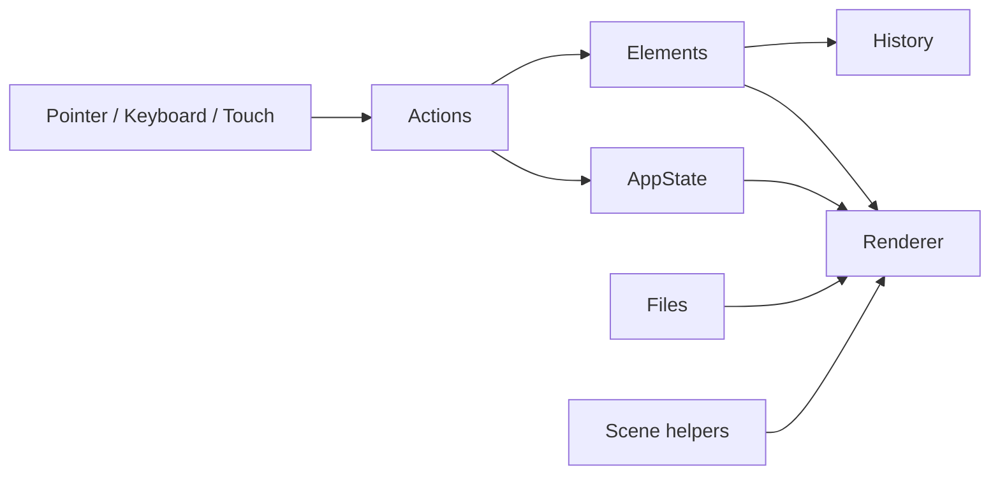
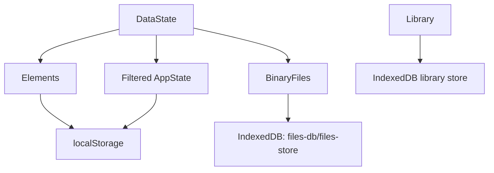
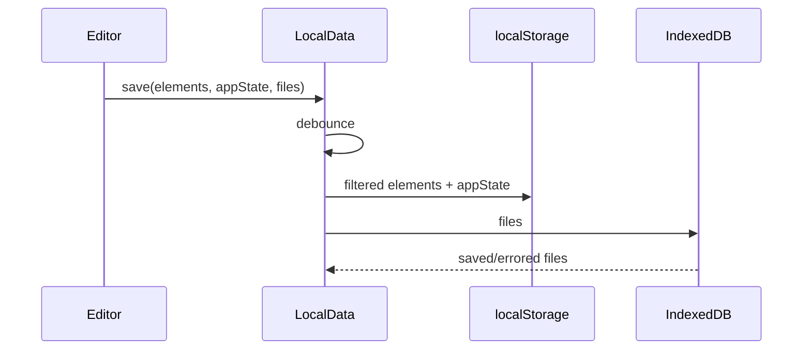
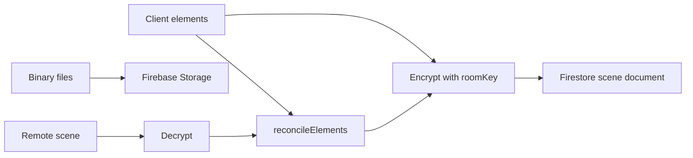
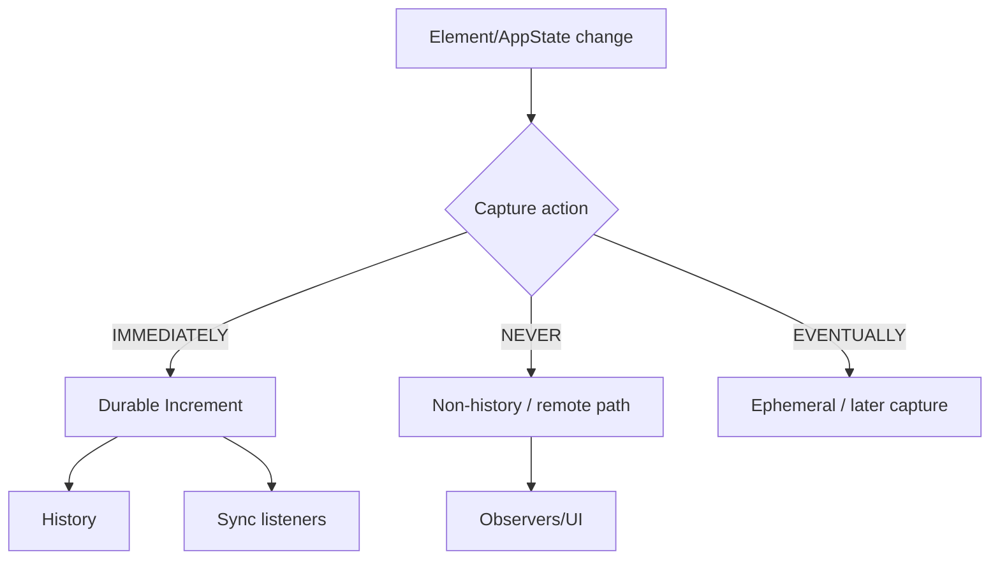
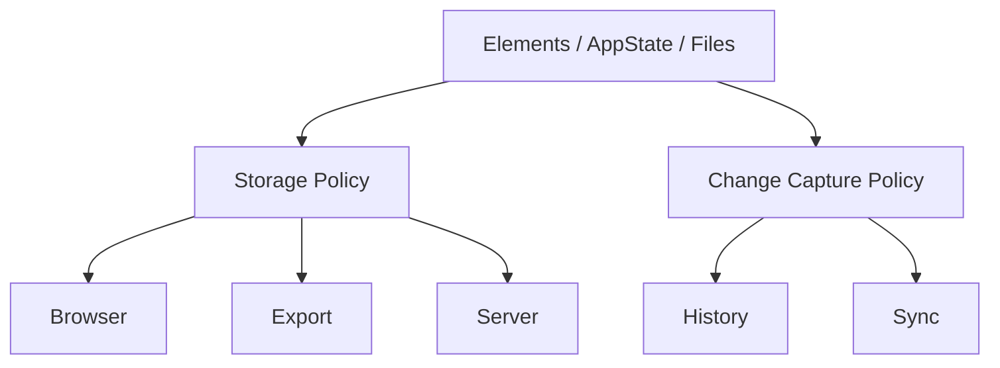

# Excalidraw — 공개 소스 기반 전체 구조도

검토 기준: 2026-11-08  
정확도: **높음(A1)** — 공식 monorepo의 embed package, hosted app, persistence/collab 소스 기준.

# 1. Product Boundary

Excalidraw은 두 층을 분리해서 보아야 한다.

```mermaid
flowchart TB
  CORE[@excalidraw/excalidraw embedded editor]
  APP[excalidraw.com application]
  APP --> CORE
  APP --> LOCAL[LocalData]
  APP --> COLLAB[Collaboration]
  APP --> SHARE[Share]
  COLLAB --> SOCKET[Socket.io realtime]
  COLLAB --> FB[Firebase persistence/storage]
```

**embedded editor package ≠ hosted excalidraw.com 기능 전체**다.

# 2. Monorepo Topology

```text
excalidraw/
├─ packages/
│  ├─ excalidraw/              main editor package
│  ├─ element/                 element geometry/transform/binding logic
│  ├─ math/
│  ├─ common/
│  ├─ fractional-indexing/
│  ├─ laser-pointer/
│  └─ utils/
├─ excalidraw-app/             hosted app
│  ├─ App.tsx
│  ├─ data/
│  │  ├─ LocalData.ts
│  │  ├─ FileManager.ts
│  │  ├─ firebase.ts
│  │  ├─ tabSync.ts
│  │  ├─ localStorage.ts
│  │  └─ ...
│  ├─ collab/
│  │  ├─ Collab.tsx
│  │  └─ Portal.tsx
│  ├─ share/
│  └─ components/
├─ firebase-project/
│  ├─ firestore.rules
│  └─ storage.rules
└─ examples/
```

# 3. Core Domain Model

핵심 상태는 크게 세 종류.

```mermaid
flowchart TB
  SCENE[Scene]
  SCENE --> ELEMENTS[ExcalidrawElement[]]
  SCENE --> APPSTATE[AppState]
  SCENE --> FILES[BinaryFiles]

  ELEMENTS --> GEOM[geometry / transform / binding / frame / groups]
  APPSTATE --> VIEW[selection / zoom / tool / UI / preferences]
  FILES --> BIN[images and binary data]
```

## Element layer

`packages/element/src`에서 확인되는 기능군:

- Scene
- binding
- bounds
- collision
- crop
- drag
- duplicate
- frame
- groups
- image
- selection
- shape
- text
- transform
- resize
- z-index / fractional indexing
- arrows / elbow arrows
- sticky note
- flowchart helpers

즉 editor UI와 element domain math가 별도 package로 분리된다.

# 4. Editor Package

`packages/excalidraw/` 주요 구조:

```text
actions/
components/
context/
data/
eraser/
hooks/
lasso/
renderer/
scene/
wysiwyg/
history.ts
appState.ts
gesture.ts
snapping.ts
viewport.ts
clipboard.ts
shortcut.ts
```

## 의미 구조



# 5. AppState Storage Policy

Excalidraw 구조에서 특히 중요한 부분.

`APP_STATE_STORAGE_CONF`는 AppState의 각 field를 목적별로 나눈다.

```text
state field
├─ browser persistence?
├─ export file?
└─ server?
```

따라서 AppState 전체를 무조건 저장하지 않는다.

예시적 의미:

```text
zoom             → browser에는 유용, 작품 파일에는 불필요할 수 있음
selection        → 개인 세션 성격
grid setting     → 작품/공유 상태가 될 수 있음
collaborators    → 영구 작품 데이터가 아님
viewport size    → 저장 불필요
```

이 패턴은 다른 편집기에서도 매우 재사용 가치가 높다.

# 6. Local Persistence

`excalidraw-app/data/LocalData.ts`에서 확인.

## 저장 위치



## 저장 흐름

- elements → deleted 제거 후 localStorage
- appState → local-save filter를 거쳐 localStorage
- BinaryFiles → IndexedDB
- save → debounce
- `flushSave()` 제공
- collaboration lock 시 local save 일시정지 가능
- `document.hidden`일 때 save pause
- quota exceeded 감지
- 쓰지 않는 binary file은 lastRetrieved 기준 정리 가능

## LocalData 구조



# 7. Hosted Collaboration

## Realtime

`Portal.tsx`:

```text
Portal
 ├─ Socket
 ├─ roomId
 ├─ roomKey
 ├─ broadcastedElementVersions
 └─ room/user events
```

주요 room events:
- init-room
- join-room
- new-user
- room-user-change
- scene broadcast
- pointer/user state broadcast

## Persistent room scene

`firebase.ts`:



확인되는 특징:
- room scene is encrypted
- sceneVersion cache
- Firestore transaction
- local + remote element reconcile
- binary files stored separately
- roomId + roomKey boundary

즉 realtime socket과 durable Firebase 저장은 별도 역할이다.

# 8. Tab / Browser Coordination

Hosted app에는 `tabSync.ts`가 별도 존재한다. LocalData save 후 browser state version을 갱신하여 storage-event 기반 탭 동기화 흐름을 지원한다.

```text
Tab A edit
 → local save
 → version update
 → other tab notices change
 → reload/merge policy
```

세부 충돌 정책은 관련 소스와 시나리오별로 확인해야 한다.

# 9. Export / Import

Core editor는:
- .excalidraw JSON
- PNG
- SVG
등의 export 경로를 가진다.

`packages/excalidraw/data`:
- json
- filesystem
- blob
- image
- restore
- reconcile
- encryption
- library

즉 import/export는 renderer와 별도 data pipeline이다.

# 10. Scene Rendering

`packages/excalidraw/scene`:
- Renderer
- export
- normalize
- scrollbars
- scene types

`packages/element`가 element geometry와 mutation을 담당하고, `scene/renderer`가 최종 그리기를 담당하는 구조로 볼 수 있다.

# 11. History

`packages/excalidraw/history.ts`가 editor core에 존재한다. History는 단순 localStorage snapshot과 별개다.

중요 설계:
- UI session change
- actual element/content change
를 같은 undo history로 무분별하게 섞지 않는 것이 핵심.

# 12. Extension / Embedding Boundary

`@excalidraw/excalidraw`을 React component로 embed 가능.

App이 제공할 수 있는 것:
- initial data
- files
- UI options
- event callbacks
- custom integration

하지만 hosted app의:
- Firebase room
- socket collaboration
- full local persistence
- hosted sharing
은 별도 app layer로 보아야 한다.

# 13. 장점

1. Element domain과 app integration이 분리되어 있다.
2. AppState 저장 정책이 매우 명시적이다.
3. JSON 상태와 BinaryFiles를 별도 저장한다.
4. hosted collab에서도 realtime과 durable persistence를 구분한다.
5. local-first 사용성과 hosted collaboration을 함께 제공한다.
6. embed component로 재사용하기 쉽다.

# 14. 단점 / 비용

1. hosted app 구조까지 참고하려면 Firebase/socket/local persistence를 함께 이해해야 한다.
2. AppState가 크기 때문에 저장 정책 관리가 중요하다.
3. collaboration reconciliation은 단순 CRUD보다 복잡하다.
4. package와 hosted app 기능을 혼동하기 쉽다.
5. localStorage + IndexedDB + Firebase + socket 등 저장 경로가 여러 개라 운영/디버깅 복잡도가 있다.

# 15. Knol에서 가져올 구조

```text
Content model
+ User AppState
+ Binary assets
        ↓
Per-destination storage policy
        ↓
local / export / share / realtime
```

특히 **“field별 저장 목적지 정책”**은 Knol 편집기 계열에 직접 적용 가치가 높다.


# 16. 실제 변경 처리 구조 — Durable vs Ephemeral

Excalidraw의 현재 core에는 `packages/element/src/store.ts`의 `Store`가 존재한다.

핵심은 변경을 모두 동일하게 취급하지 않는다는 점이다.

`CaptureUpdateAction`:

```text
IMMEDIATELY
  local durable change
  즉시 undo 대상

NEVER
  remote update / initialization 등
  undo에 절대 기록하지 않음

EVENTUALLY
  drag/async multi-step 등
  당장은 durable history로 확정하지 않음
```

Store는:
- `DurableIncrement`
- `EphemeralIncrement`

를 구분해서 emit한다.



이것은 tldraw의 record scope와 다른 축이다.

- tldraw: **무슨 종류의 상태인가**
- Excalidraw Store: **이번 변경을 어떻게 취급할 것인가**

둘을 같이 참고할 가치가 높다.

# 17. History는 snapshot 전체 복사가 아니라 Delta 기반

`history.ts`:

```text
StoreSnapshot
   ↓ compare
StoreDelta
   ↓ inverse
HistoryDelta
   ↓
undoStack / redoStack
```

중요 세부:
- element version/versionNonce는 history 복원에서 그대로 되돌리지 않음
- undo/redo도 collaboration 관점에서는 새로운 user action처럼 version이 진행되어야 함
- 단순 AppState change만으로 redo stack을 지우지 않음
- 실제 element 변경이 있을 때 redo reset

즉 history가 **협업과 충돌하지 않도록 별도 의미론**을 가진다.

# 18. 저장 구조는 '상태 종류'와 '변경 종류' 두 축

Excalidraw을 더 정확히 모델링하면:

```text
축 A: 무엇인가?
- elements
- appState
- binary files

축 B: 어디 저장하는가?
- browser
- export
- server

축 C: 이번 변경은 무엇인가?
- durable
- ephemeral
- remote/non-history
```

따라서:



# 19. FileManager 계층

Hosted app은 binary file 처리를 `FileManager`로 분리한다.

책임:
- fetching 중 file 추적
- error 상태
- upload/save
- file version
- encoded upload
- local manager / collaboration manager에서 재사용

즉 binary asset는 단순 `Map<id, data>`가 아니라 별도 lifecycle manager를 가진다.

# 20. Collaboration의 두 채널

Excalidraw hosted collaboration은 실질적으로:

```text
Realtime channel
  Socket.io
  - scene broadcasts
  - users
  - pointer/presence

Durable channel
  Firebase
  - encrypted scene
  - binary files
```

로 분리된다.

이 구조는 “WebSocket이 있으니 저장도 해결된다”는 오해를 막아준다.

# 21. Source Evidence

- `packages/element/src/store.ts`
- `packages/excalidraw/history.ts`
- `packages/excalidraw/appState.ts`
- `packages/excalidraw/scene/Renderer.ts`
- `packages/excalidraw/data/*`
- `excalidraw-app/data/LocalData.ts`
- `excalidraw-app/data/FileManager.ts`
- `excalidraw-app/data/firebase.ts`
- `excalidraw-app/collab/Collab.tsx`
- `excalidraw-app/collab/Portal.tsx`
