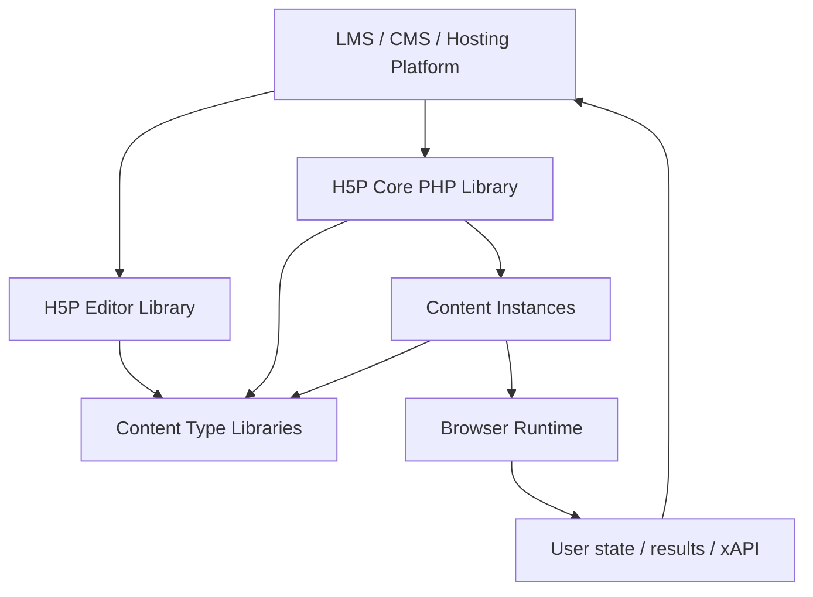
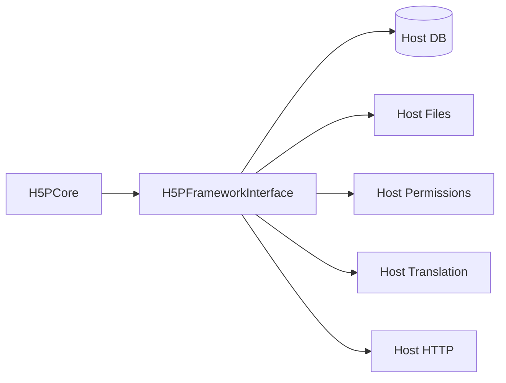
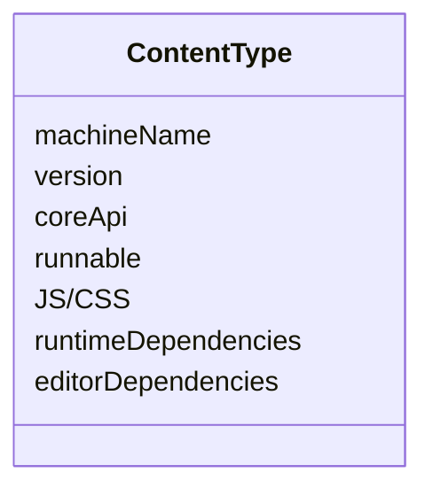
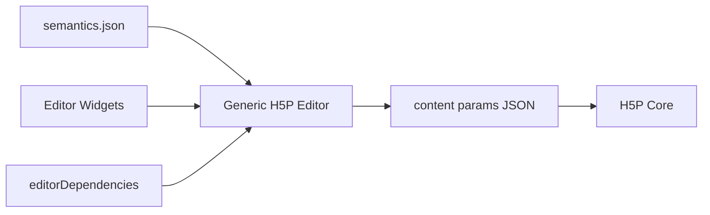
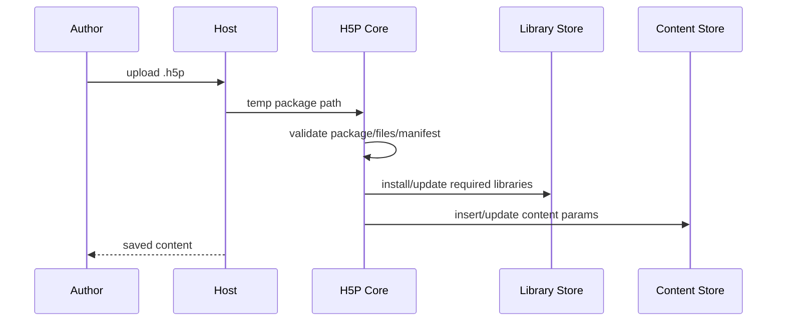
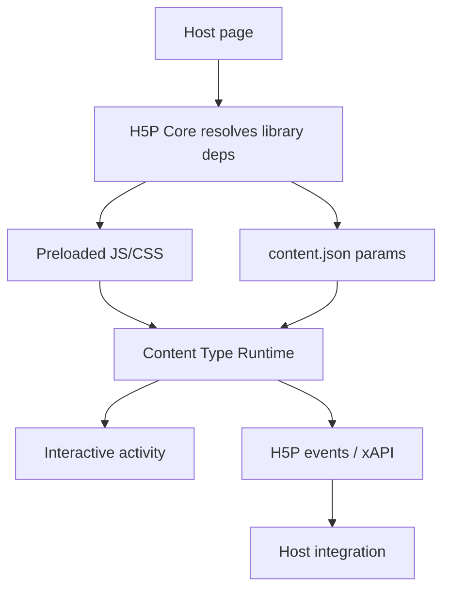
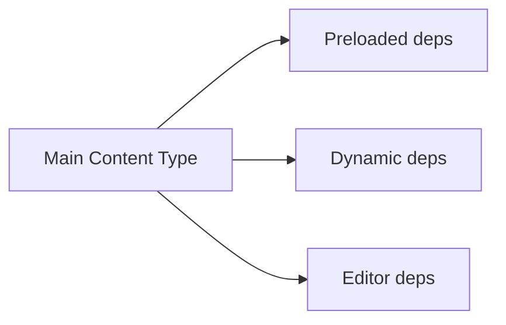

# H5P — 공개 소스·규격 기반 전체 구조도

검토 기준: 2026-11-08  
정확도: **높음(A1/A2)** — H5P core PHP library, editor PHP library, 실제 content type repository와 specification 기준.

# 1. H5P는 하나의 앱이 아니라 계층형 플랫폼



핵심: H5P core는 특정 LMS에 종속되지 않고 **framework interface를 통해 host가 저장·권한·파일·DB 기능을 구현**한다.

# 2. Repository / Component Topology

H5P 생태계는 하나의 monorepo가 아니라 여러 repository로 분리된다.

```text
h5p-php-library
  core engine / package validation / framework interfaces

h5p-editor-php-library
  generic authoring editor

h5p-multi-choice
h5p-interactive-video
h5p-branching-scenario
...
  each content type library

Platform integration
  WordPress / Drupal / Moodle / H5P.com etc.
```

# 3. Host Framework Boundary

`H5PFrameworkInterface`에서 확인되는 host 책임:

- platform info
- HTTP fetch
- translation
- uploaded H5P file/folder paths
- installed library lookup
- library data storage
- content insert/update
- content user data reset
- library dependency storage
- whitelists
- permissions
- messages/errors
- file URLs
- development/update policy

즉 H5P core가 DB를 직접 소유하는 것이 아니라 **host가 persistence contract를 구현**한다.



# 4. Content Type Anatomy

실제 `H5P.MultiChoice` repository:

```text
h5p-multi-choice/
├─ library.json
├─ semantics.json
├─ js/
├─ css/
├─ language/
├─ presave.js
└─ upgrades.js
```

InteractiveVideo:

```text
h5p-interactive-video/
├─ library.json
├─ semantics.json
├─ src/
│  ├─ entries/
│  ├─ gui/
│  ├─ scripts/
│  └─ styles/
├─ language/
├─ presave.js
├─ upgrades.js
└─ webpack.config.js
```

# 5. library.json — 타입 manifest

실제 MultiChoice에서 확인되는 주요 field:

```text
title
contentType
machineName
majorVersion
minorVersion
patchVersion
runnable
embedTypes
coreApi
preloadedJs
preloadedCss
preloadedDependencies
editorDependencies
license
```

따라서 Content Type은:



# 6. semantics.json — Data + Authoring Contract

semantics는 content instance가 어떤 데이터를 가지는지 선언한다.

확인되는 구조:

```text
field
├─ name
├─ type
├─ label
├─ importance
├─ optional
├─ default
├─ widget
├─ fields
├─ list.field
├─ options
└─ showWhen
```

## 예: MultiChoice

```text
media
 └─ nested library: Image / Video / Audio

question
answers[]
 ├─ text
 ├─ correct
 └─ tipsAndFeedback

overallFeedback
UI translations
behaviour/options
```

## 예: Interactive Video

```text
interactiveVideo
├─ video
│  ├─ files
│  ├─ start screen
│  └─ text tracks
└─ assets/interactions
   ├─ duration
   ├─ pause
   ├─ displayType
   ├─ buttonOnMobile
   ├─ x/y/width/height
   └─ nested interaction library
```

즉 semantics는 단순 schema보다 **저작 UI 생성 정보**까지 포함한다.

# 7. Editor Architecture

`h5p-editor-php-library` 실제 구조:

```text
h5peditor.class.php
h5peditor-ajax.class.php
h5peditor-storage.interface.php
scripts/
├─ h5peditor-form.js
├─ h5peditor-group.js
├─ h5peditor-list.js
├─ h5peditor-library.js
├─ h5peditor-library-selector.js
├─ h5peditor-file.js
├─ h5peditor-image.js
├─ h5peditor-text.js
├─ h5peditor-number.js
├─ h5peditor-boolean.js
├─ h5peditor-select.js
├─ h5peditor-semantic-structure.js
└─ ...
ckeditor / ckeditor5
language/
styles/
```

## 흐름



Generic editor는 semantics를 읽고 field/widget를 조합한다. 복잡한 타입은 전용 editor dependency/widget를 추가한다.

# 8. .h5p Package Structure

개념적으로:

```text
package.h5p  (ZIP container)
├─ h5p.json
├─ content/
│  └─ content.json
├─ H5P.SomeLibrary-x.y/
│  ├─ library.json
│  ├─ semantics.json
│  ├─ js/css
│  └─ ...
└─ media/assets
```

주의: 모든 배포 패키지가 항상 모든 dependency library를 포함해야 한다는 식으로 단순화하면 안 된다. host/packaging context에 따라 dependency resolution이 관여한다.

# 9. Install / Upload Flow



# 10. Runtime Flow



# 11. Dependency Model

dependency 종류가 구분된다.

- preloaded
- dynamic
- editor



이 구조 때문에 H5P content type은 단일 JS 파일보다 **작은 dependency graph**에 가깝다.

# 12. Version / Upgrade

Content Type은 major/minor/patch를 가진다.

각 library는 `upgrades.js` 등을 통해 이전 content params 업그레이드를 제공할 수 있다.

```text
old params
  ↓
library upgrade path
  ↓
new params
  ↓
new runtime
```

호스트의 installed library version과 content의 required version이 호환성의 핵심이다.

# 13. State / Results

H5P runtime은:
- content params
- runtime state
- completion/score
- xAPI events
를 구분한다.

이어하기(current state)는 **모든 content type이 자동 지원하는 공통 보장 기능이 아니라**, 해당 타입과 host integration의 지원 여부가 영향을 준다.

# 14. 장점

1. Content Type이 독립 버전·dependency 단위를 가진다.
2. authoring과 runtime이 명확히 분리된다.
3. semantics 기반 generic editor가 확장 비용을 줄인다.
4. host platform과 core의 계약이 분명하다.
5. import/export 및 재사용에 유리하다.
6. 다국어·접근성·평가 이벤트를 생태계 수준에서 다룰 수 있다.

# 15. 단점 / 비용

1. library/dependency/version graph가 복잡하다.
2. content type 수가 많아질수록 UI 선택 피로가 생긴다.
3. generic editor는 전용 UX보다 덜 직관적일 수 있다.
4. host integration이 필요해 standalone 앱보다 운영 구조가 무겁다.
5. core, editor, content library의 라이선스가 모두 같다고 단정하면 안 된다.
6. upgrade 호환성을 장기간 관리해야 한다.

# 16. Knol에서 가져올 구조

```text
Activity Manifest
 ├─ id/version
 ├─ data schema
 ├─ authoring metadata
 ├─ author renderer
 ├─ player renderer
 ├─ dependencies
 └─ migrate
```

다만 실제 활동 타입이 충분히 반복된 뒤 도입해야 한다.
