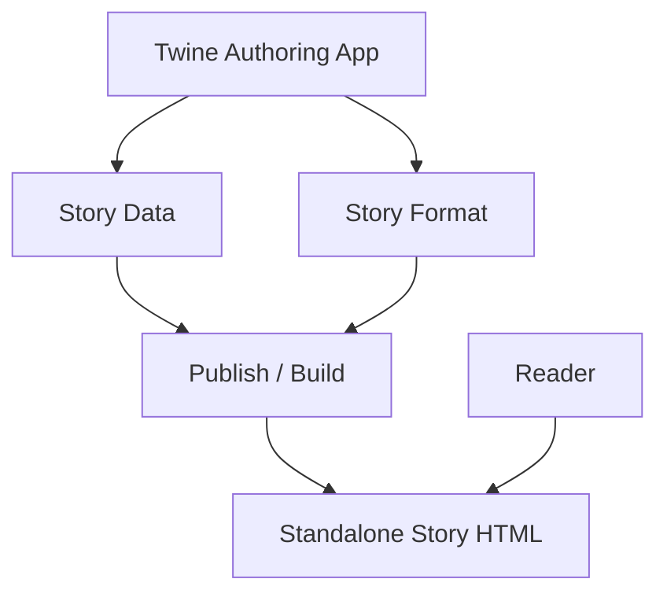
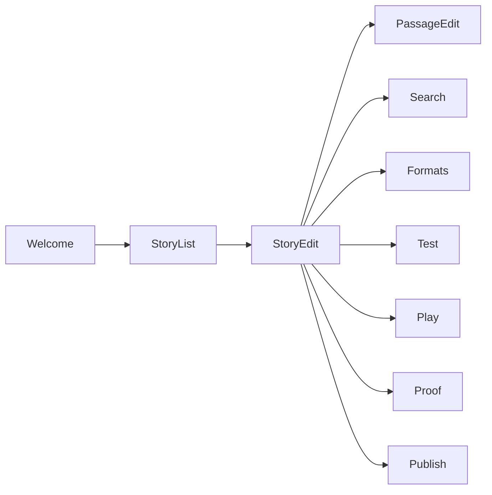
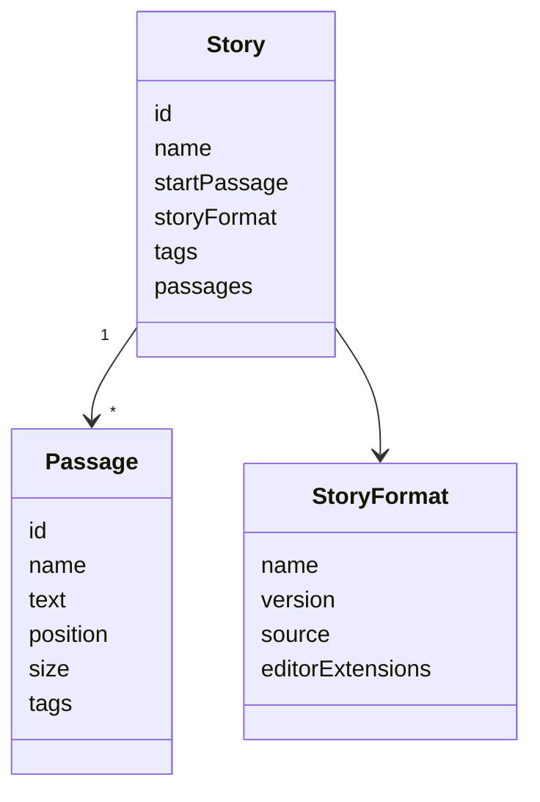
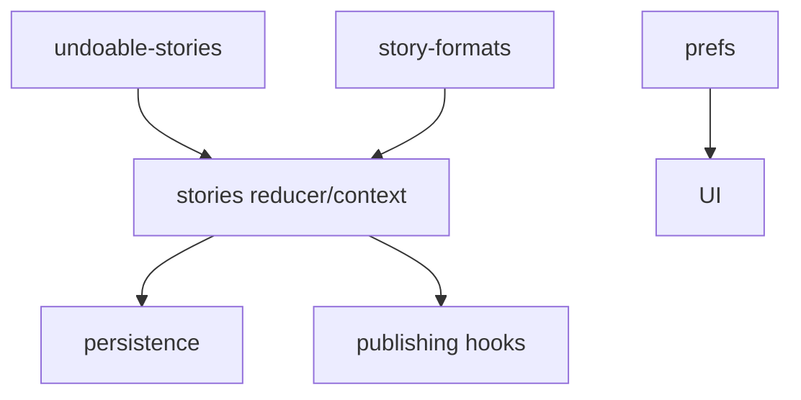
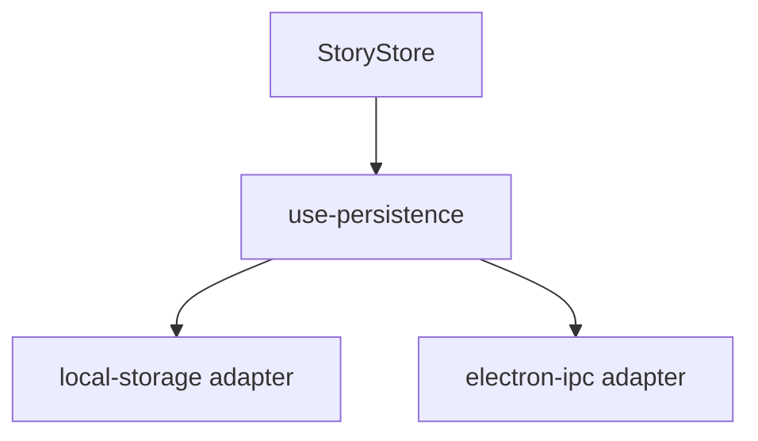
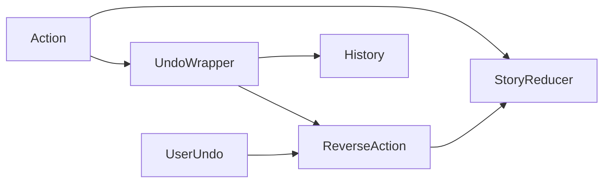
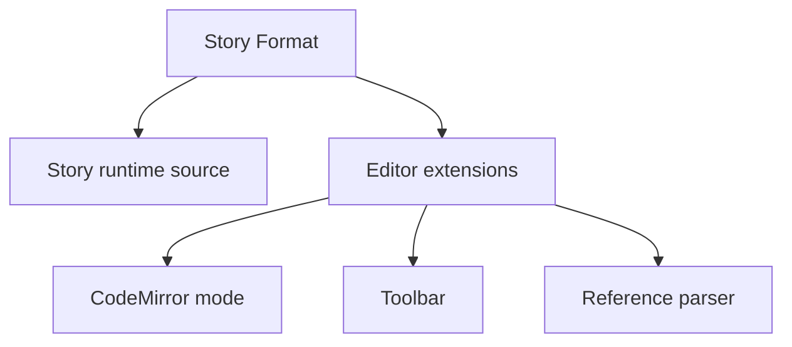
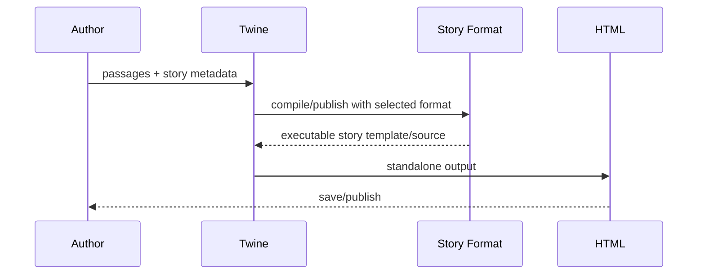

# Twine — 공개 소스 기반 전체 구조도

검토 기준: 2026-11-08  
정확도: **높음(A1/A2)** — 공식 twinejs source, Design Goals, Reference, extension spec 기준.

# 1. Product Boundary

Twine은 **story authoring application**이고, 실제 이야기를 실행하는 의미론은 선택된 Story Format이 크게 담당한다.



# 2. Repository Topology

```text
twinejs/
├─ src/
│  ├─ app.tsx
│  ├─ routes/
│  │  ├─ story-list/
│  │  ├─ story-edit/
│  │  ├─ story-play/
│  │  ├─ story-proof/
│  │  ├─ story-test/
│  │  └─ welcome/
│  ├─ components/
│  │  ├─ passage/
│  │  ├─ story/
│  │  ├─ story-format/
│  │  ├─ tag/
│  │  ├─ fuzzy-finder/
│  │  └─ ...
│  ├─ dialogs/
│  │  ├─ passage-edit/
│  │  ├─ story-details/
│  │  ├─ story-formats/
│  │  ├─ story-import/
│  │  └─ story-search/
│  ├─ store/
│  │  ├─ stories/
│  │  ├─ undoable-stories/
│  │  ├─ persistence/
│  │  ├─ story-formats/
│  │  ├─ prefs/
│  │  └─ publishing hooks
│  ├─ codemirror/
│  └─ util/
├─ docs/
├─ e2e/
└─ electron/
```

# 3. UX / Route Architecture



Twine의 핵심 UI는 story map 편집과 passage 편집의 결합이다.

# 4. Story Domain Model

개념 모델:



실제 type field는 현재 소스 버전에 따라 달라질 수 있으므로 이 다이어그램은 의미 관계를 표현한다.

# 5. Story Map Structure

Passage의 위치 자체가 authoring data에 포함되어 map을 구성한다.

```text
Passage
├─ content
├─ title/name
├─ tags
├─ map position
└─ links inferred/parsing
```

link는 passage text를 parser/reference parser가 분석해 story map 관계로 표현할 수 있다.

## 시각적 진단

공식 Reference와 UI에서:
- 시작 passage
- broken link
- empty passage
- tag
- search/fuzzy finder
를 구조상 확인할 수 있다.

# 6. Store Architecture

`src/store`가 명확히 분리됨:



## stories

```text
stories/
├─ action-creators/
├─ reducer/
├─ defaults.ts
├─ getters.ts
├─ stories-context.tsx
└─ stories.types.ts
```

## undo

```text
undoable-stories/
├─ reducer.ts
├─ reverse-action.ts
├─ reverse-thunk.ts
└─ context
```

즉 undo는 story reducer에 무작정 섞지 않고 별도 wrapper/logic으로 분리한다.

# 7. Persistence Boundary

`src/store/persistence`:

```text
persistence/
├─ local-storage/
├─ electron-ipc/
├─ persistable-changes.ts
└─ use-persistence.ts
```

즉 browser Twine과 desktop/Electron Twine이 가능한 한 같은 authoring experience를 유지하면서 **저장 adapter가 다르다.**



Twine Design Goals는 web-native를 명시하고 browser/app 사용자 경험을 가능한 한 동일하게 유지하는 것을 목표로 한다.

# 8. Undo Architecture



정확한 reducer implementation보다 중요한 구조는 **story domain action과 undo 의미를 분리**했다는 점이다.

# 9. Story Format Architecture

Story Format은 단순 theme가 아니다.

```text
StoryFormat
├─ name
├─ version
├─ source (runtime/compiler template)
└─ editorExtensions
   ├─ CodeMirror mode
   ├─ commands
   ├─ toolbar
   └─ reference parser
```

## Extension rule

공식 `EXTENDING.md`:
- standalone extension은 불가
- extension은 story format에 bundle
- 사용자는 format extension을 disable할 수 있음
- extension은 story 실행에 필수여서는 안 됨
- version specifier로 Twine version과 호환성 선언



# 10. Publish Pipeline



Twine authoring app 없이도 최종 HTML은 실행될 수 있다.

# 11. Runtime State Boundary

중요: runtime variable/history는 Twine authoring store와 같은 것이 아니다. 실제 runtime semantics는 Harlowe, SugarCube 등 **story format**이 제공한다.

```text
Twine authoring state
 ≠
published story runtime state
```

이 구분이 매우 중요하다.

# 12. Design Goals

공식 목표:
- Easy to Learn
- Accessible
- Web Native

구체적으로:
- 초보자는 basic links를 빠르게 배울 수 있어야 함
- sensible defaults
- undoable actions
- technical jargon 회피
- icon-only button 최소화
- keyboard/screen reader 고려
- touchscreen 고려
- hover-only interaction 회피
- browser/desktop 최대한 동일 경험
- dependency/download size 신중

이 부분은 코드 구조 못지않게 Twine 제품 구조를 설명한다.

# 13. 장점

1. story map과 passage editor가 강하게 결합된다.
2. authoring app과 published runtime을 분리한다.
3. story format이 실행 의미론을 확장한다.
4. persistence adapter가 browser/Electron 차이를 흡수한다.
5. undo가 story state 구조와 독립적으로 관리된다.
6. 초보자/접근성 원칙이 명시되어 있다.

# 14. 단점 / 비용

1. Story Format이 여러 개라 runtime semantics가 통일되지 않는다.
2. format-specific macro를 이해해야 고급 기능을 쓸 수 있다.
3. authoring graph와 실제 조건 runtime reachability는 다를 수 있다.
4. 자유도가 커질수록 초보자에게 복잡하다.
5. extension이 story format에 묶여 독립 plugin 생태계와는 다르다.

# 15. Knol에서 가져올 구조

놀스토리는 이미 자체 runtime/domain이 강하므로 가져올 핵심은:

```text
Existing StoryDocument / Runtime Core
          +
Read-only Story Map
          +
Visual diagnostics
          +
Search / tags / structural navigation
```

이다. Twine runtime을 이식할 필요는 없다.
