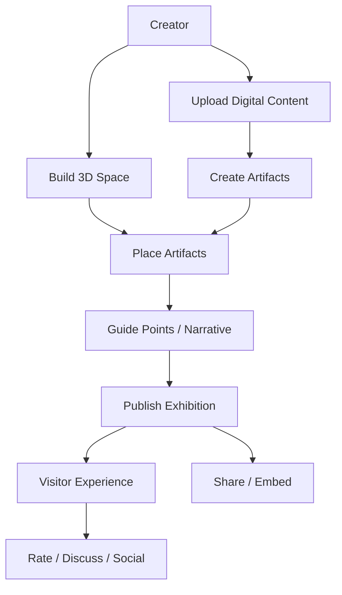
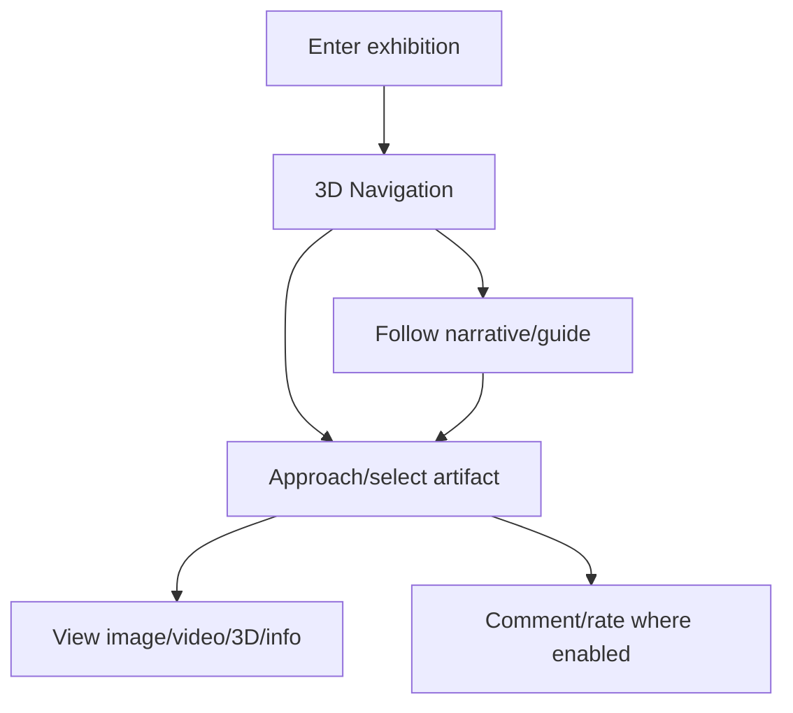
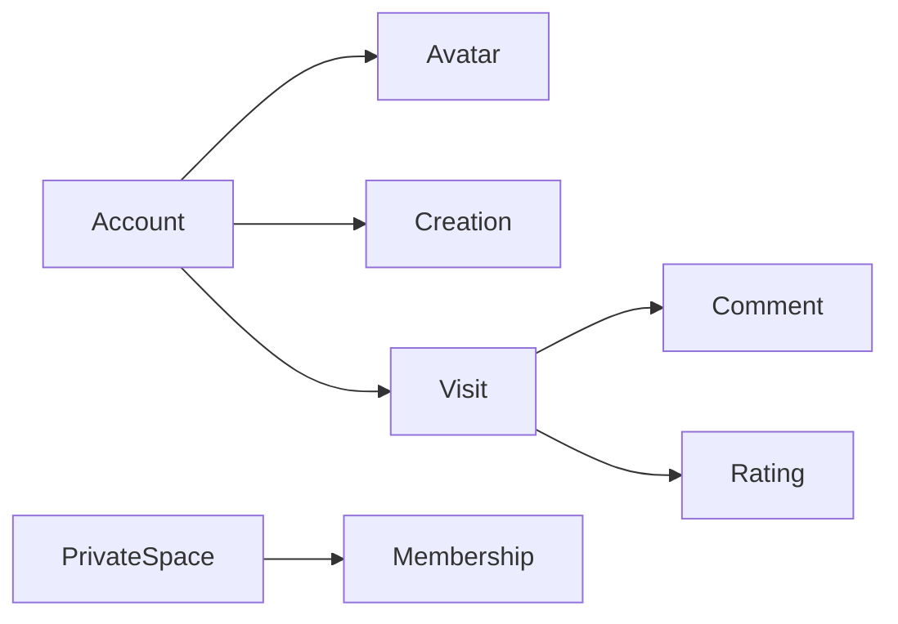
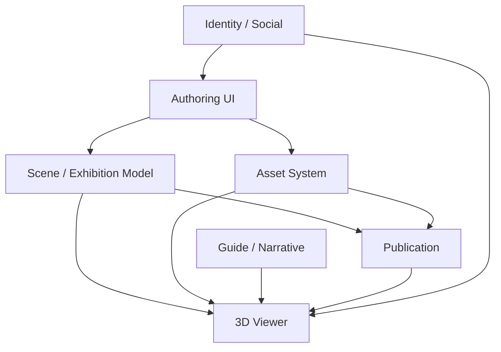
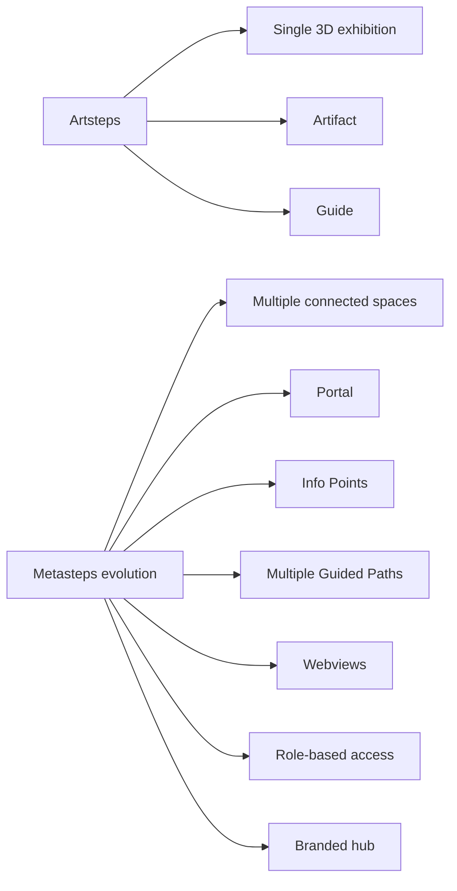

# Artsteps — 외부에서 관찰 가능한 전체 구조도

검토 기준: 2026-11-08  
정확도: **중간(B/C)** — 공식 제품 설명·공식 블로그에서 확인 가능한 기능 기준. 내부 source/server/database는 비공개.

> Artsteps의 실제 내부 코드·DB·렌더링 엔진·서버 토폴로지는 공개 확인할 수 없다. 따라서 이 문서는 **제품 기능 구조는 B**, 내부 모듈 관계는 **C(추론)** 로 명확히 구분한다.

# 1. 공식적으로 확인되는 Product Model (B)

공식 설명에서 확인되는 주요 능력:

- browser-based 3D virtual exhibition authoring
- 3D room/space 구성
- 2D artifact: paintings/photos/posters
- 3D artifact: sculptures/installations
- streaming video
- audio/narration 가능
- exhibition navigation
- guide point / storytelling
- avatars / social interaction 관련 기능
- rating / discussion
- share / embed
- private/custom branded spaces 일부 제공
- desktop, smartphone, tablet, VR navigation 안내

# 2. Product Structure (B)



# 3. Authoring Structure (B/C)

```text
Exhibition
├─ Space
│  ├─ rooms
│  ├─ walls
│  ├─ floor
│  ├─ textures/colors
│  └─ environment
├─ Artifacts
│  ├─ image / painting / photo / poster
│  ├─ video
│  ├─ text/information
│  └─ 3D object
├─ Placement
│  ├─ position
│  ├─ rotation
│  └─ scale
├─ Narrative / Guide
│  └─ guide points / sequence
├─ Publication
│  ├─ visibility/access
│  ├─ share
│  └─ embed
└─ Social / Visitor
   ├─ avatar
   ├─ comments/discussion
   └─ rating
```

위 데이터 모델의 정확한 field/schema는 비공개이므로 개념 구조다.

# 4. Creation Flow (B)

공식 설명을 기반으로 한 사용자 흐름:


# 5. Viewer Structure (B/C)



실제 카메라 interpolation, collision, navmesh, pointer lock, WebGL engine 등은 Unknown.

# 6. Guide Point System — 가장 중요한 개념

공식 설명에서 guide/storytelling이 확인된다.

내부 구현은 알 수 없지만 제품 구조상 다음 역할을 한다고 해석할 수 있다(C).

```text
Guide Point
├─ spatial target
├─ narrative order
└─ visitor guidance
```

이 개념의 핵심은:
- 공간 좌표
- 관람 순서
- 설명/서사
를 연결한다는 점이다.

# 7. Social / Identity Boundary (B)

공식 블로그 설명상 등록 사용자/아바타/communication/comments 등 social layer가 존재한다.



정확한 auth provider, DB schema, moderation system은 Unknown.

# 8. Publishing / Embedding (B)

완성된 전시는:
- Artsteps 사이트에서 탐색
- social/digital channels 공유
- 다른 웹사이트에 embed
- 일부 조직용 custom/private space
방식으로 배포된다.

즉 authoring project와 viewer publication의 경계가 존재한다고 보는 것이 합리적이다.

# 9. 내부 기술 아키텍처 — 확인 불가

다음은 공개 근거가 없어 **Unknown**:
- frontend framework
- WebGL/3D engine
- scene graph format
- database
- object storage
- realtime protocol
- autosave implementation
- collision/navmesh
- camera controller internals
- cache/CDN
- backend language
- deployment topology

이를 임의로 Three.js/Unity/WebSocket 등으로 단정하지 않는다.

# 10. 추론 가능한 논리 계층 (C)

제품 기능만 놓고 보면 최소 다음 책임은 존재해야 한다.



이것은 **필요 책임의 논리 구조**이지 Artsteps 내부 source tree가 아니다.

# 11. 장점

1. 3D 제작과 관람을 하나의 web product로 연결한다.
2. 다양한 artifact type을 동일 공간에 넣는다.
3. guide/narrative로 자유 공간에 관람 의도를 추가한다.
4. viewer/share/embed까지 creation lifecycle이 이어진다.
5. 교육·박물관·전시에 적합한 공간 메타포다.

# 12. 단점 / 비용

1. 3D 자체가 기기 성능과 입력 난도를 높인다.
2. 공간이 크면 길찾기 비용이 생긴다.
3. 자유 이동은 모바일/저숙련 사용자에게 부담이다.
4. 2D보다 제작 시간이 길 수 있다.
5. 내부 구조가 비공개라 기술 구현을 직접 참고하기 어렵다.
6. hosted service 의존 구조라 export/portability 범위는 별도 확인이 필요하다.

# 13. 놀아트에 가져올 구조

Artsteps의 내부 기술을 복제하기보다 다음 개념 구조를 가져오는 것이 적합하다.

```text
Exhibition
├─ Artwork
├─ Placement
├─ Viewpoint
├─ Tour
└─ Publication
```

특히:

```text
Artwork position
≠
Visitor viewpoint

Free movement
+
Guided route
+
2D fallback
```

가 핵심이다.

# 14. 공식 근거

- https://www.artsteps.com/
- https://blog.artsteps.com/about
- https://blog.artsteps.com/artsteps-make-your-own-virtual-exhibitions-1cbdc3a36146
- https://blog.artsteps.com/


# 15. 2025 이후 진화 — Metasteps에서 확인되는 구조적 방향

Artsteps 공식 채널은 2025-09-15에 Metasteps를 Artsteps의 next-generation evolution으로 설명했다.

확인되는 요구 변화:
- 더 자유로운 no-code 3D design
- realistic lighting/materials
- 더 많은 interactivity
- access control / member management
- scalability

그리고 새로운 개념이 구체적으로 공개되었다.

## Portal

서로 다른 3D 공간을 연결.

```text
Space A
  ↓ portal
Space B
  ↓ portal
Space C
```

이는 단일 room/exhibition에서 **space graph**로 확장되는 구조다.

## Info Point

공간 객체에 맥락/설명 정보를 연결.

```text
Spatial Object
     ↓
Info Point
     ↓
Context / explanation / interaction
```

## Guided Paths

하나의 공간에 여러 narrative flow를 설계할 수 있다고 명시한다.

기존 '하나의 guide sequence'보다 발전된 개념:

```text
Environment
├─ Path A: 초보 관람
├─ Path B: 심화 관람
└─ Path C: 특정 주제 관람
```

교육 서비스에는 특히 가치가 크다.

## Webviews

3D 공간에 live web content embedding:
- survey
- questionnaire
- web form
- collaboration platform
- presentation

구조적으로 보면:

```text
3D Scene
  ├─ native artifact
  ├─ media artifact
  └─ web surface / embedded application
```

로 확장된다.

## Access Control

공식 설명:
- member-only access
- role-based permissions
- Districts branded hub
- self-service management

따라서 제품 논리 구조는 최소:

```text
Account
  ↓
Membership
  ↓
Role
  ↓
District / Space
  ↓
Permission
```

까지 확장된 것으로 볼 수 있다.

# 16. Artsteps → Metasteps 구조 진화의 의미



이것은 놀아트의 당장 구현 범위를 늘리라는 뜻이 아니다.

오히려 장기적으로 전시 시스템이 커질 때:
- 작품
- 관람점
- 투어
- 공간
- 공간 연결
- 역할/권한

을 각각 별도 개념으로 두는 것이 유리하다는 참고 자료다.

# 17. 최신 공식 근거

2025-09-15 공식 ArtSteps 채널:
- Artsteps가 수년간 3D 전시·교육·스토리텔링에 사용됨
- Metasteps를 차세대 진화로 소개
- Portals
- Info Points
- Guided Paths
- Webviews
- member-only access
- role-based permissions
- Districts

원문:
https://blog.artsteps.com/from-artsteps-to-metasteps-the-next-chapter-in-immersive-creation-5ddb6bc90a72

이 기능들의 **제품 존재는 확인**되지만, 내부 기술 구현은 여전히 Unknown이다.
