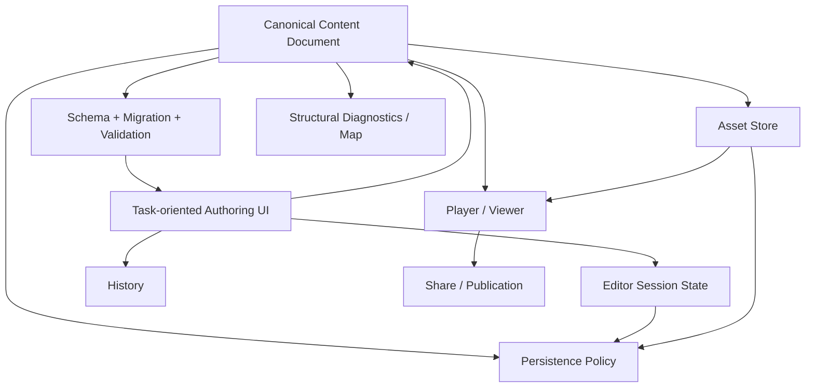

# 5개 도구 — 전체 구조 비교 지도

검토 기준: 2026-11-08

# 1. 가장 높은 수준의 구조

```mermaid
flowchart TB
  subgraph TL[tldraw]
    TLUI[UI] --> TLE[Editor]
    TLE --> TLS[Store]
    TLS --> TLST[Reactive State]
    TLS --> TLSC[Schema]
    TLS --> TLPS[Persistence / Sync]
  end

  subgraph EX[Excalidraw]
    EXUI[Editor UI] --> EXEL[Elements]
    EXUI --> EXAS[AppState]
    EXUI --> EXF[BinaryFiles]
    EXEL --> EXP[Storage Policy]
    EXAS --> EXP
    EXF --> EXP
    EXP --> EXL[Local / Export / Server / Collab]
  end

  subgraph H5[H5P]
    HOST[Host LMS/CMS] --> CORE[Core]
    CORE --> CT[Content Type]
    EDIT[Editor] --> CT
    CT --> RUN[Runtime]
    RUN --> EVENT[State / xAPI]
    EVENT --> HOST
  end

  subgraph TW[Twine]
    MAP[Story Map] --> STORY[Story/Passages]
    STORY --> FORMAT[Story Format]
    FORMAT --> HTML[Published Runtime]
  end

  subgraph AR[Artsteps]
    SPACE[3D Space] --> ART[Artifacts]
    ART --> GUIDE[Guide / Narrative]
    GUIDE --> VIEW[Viewer]
    VIEW --> PUB[Share / Embed / Social]
  end
```



# 2. 무엇을 '진실 원천'으로 보는가

| 도구 | Canonical에 가까운 핵심 |
|---|---|
| tldraw | typed record store |
| Excalidraw | elements + selected persisted AppState + BinaryFiles |
| H5P | content instance params + referenced content type/version/dependencies |
| Twine | story/passage authoring data + selected story format |
| Artsteps | 비공개; 개념적으로 exhibition scene + artifacts + guide |

# 3. 편집 상태 분리 방식

| 도구 | 결과물과 사용자 상태 분리 |
|---|---|
| tldraw | document / session / presence scope가 가장 명시적 |
| Excalidraw | AppState field마다 browser/export/server 포함 여부를 세밀하게 결정 |
| H5P | content params와 editor UI/runtime state 분리 |
| Twine | authoring store와 published runtime state 분리 |
| Artsteps | authoring/viewer 경계는 관찰되나 내부 state 구조 Unknown |

# 4. 저장 시스템

| 도구 | Local | File/Package | Server/Sync |
|---|---|---|---|
| tldraw | IndexedDB persistence | store snapshot/export | tldraw sync + pluggable storage |
| Excalidraw | localStorage + IndexedDB files | .excalidraw / PNG / SVG | socket realtime + Firebase durable scene/files |
| H5P | host dependent | .h5p package | host LMS/CMS database/files |
| Twine | browser local storage / Electron adapter | HTML / Twee/import-export | 중앙 협업 서버가 core 전제는 아님 |
| Artsteps | Unknown | portability 범위 별도 확인 | hosted service |

# 5. Binary Asset Architecture

| 도구 | 방식 |
|---|---|
| tldraw | TLAsset record + TLAssetStore binary backend 분리 |
| Excalidraw | elements/AppState와 BinaryFiles 분리, IDB/Firebase Storage |
| H5P | content package/media files + host file storage |
| Twine | story/source and imported assets; runtime format/output에 통합 가능 |
| Artsteps | artifact upload 존재만 확인, 저장 구현 Unknown |

# 6. Extension Model

| 도구 | 확장 단위 |
|---|---|
| tldraw | shapes, bindings, tools, UI, records, asset/persistence/sync adapters |
| Excalidraw | embedded React editor configuration/integration; hosted app source modification |
| H5P | versioned content library + semantics + dependencies |
| Twine | Story Format + versioned editor extensions |
| Artsteps | creator-facing artifact/space features; developer plugin model은 공개 확인 불가 |

# 7. Runtime과 Authoring

```text
tldraw:
Authoring ≈ runtime editor itself

Excalidraw:
Authoring ≈ runtime editor itself

H5P:
Authoring Editor → separate Content Runtime

Twine:
Authoring Twine → separate Published Story Runtime

Artsteps:
Exhibition Authoring → Viewer Experience
```

교육 서비스에서는 H5P/Twine/Artsteps의 **Authoring → Runtime/Viewer 분리**가 특히 중요하다.

# 8. 구조적으로 가장 배울 가치가 큰 것

## tldraw
**Lifecycle architecture**

```text
state → store → schema → editor → persistence/sync
```

## Excalidraw
**Destination-aware persistence**

```text
state field → browser/export/server/realtime policy
```

## H5P
**Versioned extensible content platform**

```text
manifest + schema + editor + runtime + dependencies + upgrade
```

## Twine
**Human-readable graph authoring**

```text
passage map + structural diagnostics + publishing boundary
```

## Artsteps
**Spatial consumption model**

```text
artifact placement + viewpoint/guide + viewer + share
```

# 9. Knol 서비스용 통합 참조 모델

이 다섯 구조를 그대로 합치는 것이 아니라 다음처럼 필요한 원리만 통합할 수 있다.



## 상태 저장 정책

```text
Content field
  → document/export/server/history

Editor session
  → browser only

Presence
  → realtime only

Binary asset
  → asset store + export/server if needed

Runtime progress
  → separate player/session persistence
```

# 10. 결론

다섯 도구를 구조적으로 보면 서로 다른 문제를 푼다.

- **tldraw:** 편집기의 내부 질서
- **Excalidraw:** 편집 상태와 저장 목적의 질서
- **H5P:** 콘텐츠 생태계의 질서
- **Twine:** 분기 저작 구조의 질서
- **Artsteps:** 공간 관람 경험의 질서

이 구분을 유지해야 각각의 장점을 잘 재사용할 수 있다.
