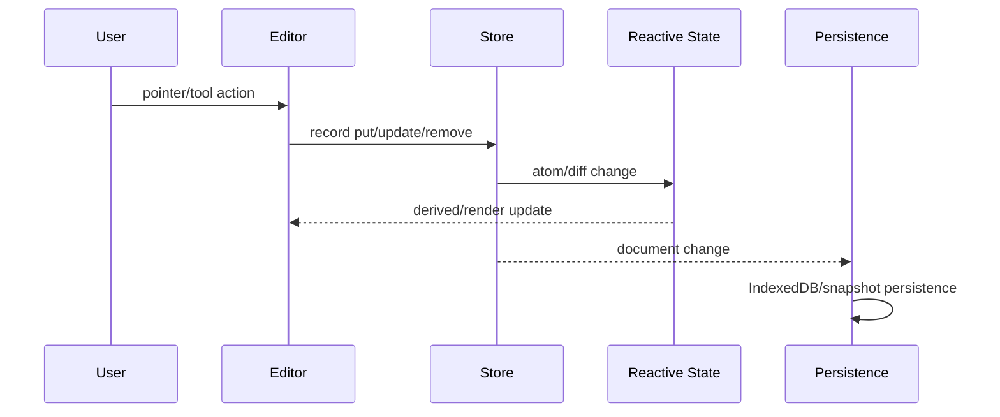
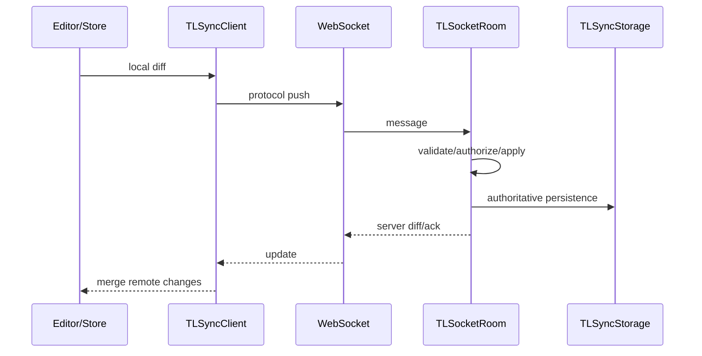
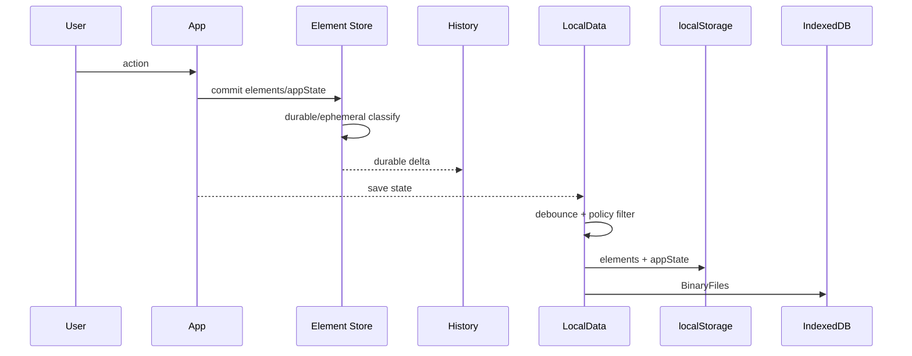
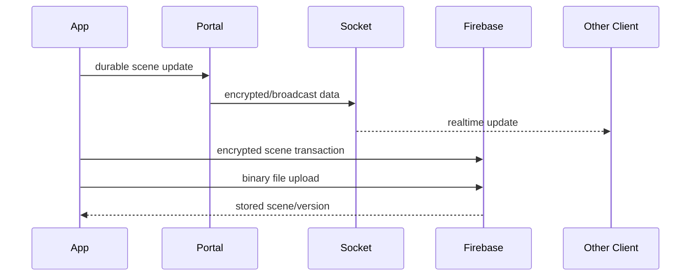
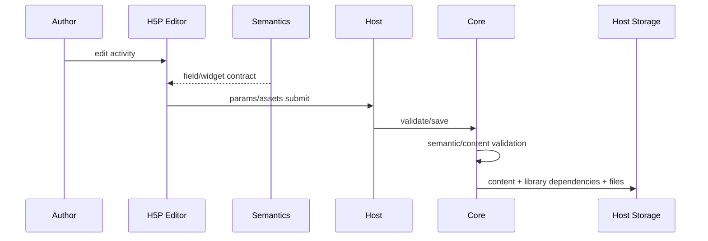
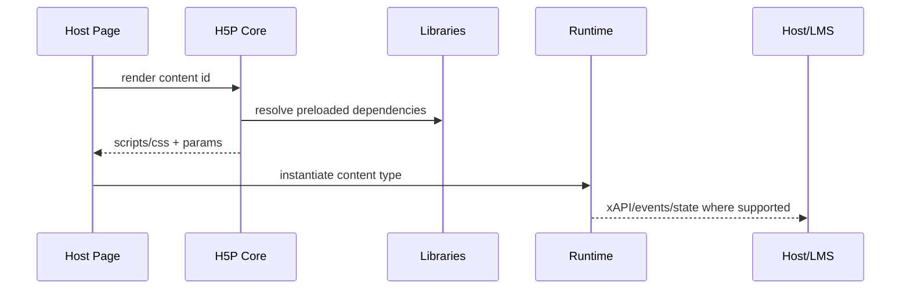
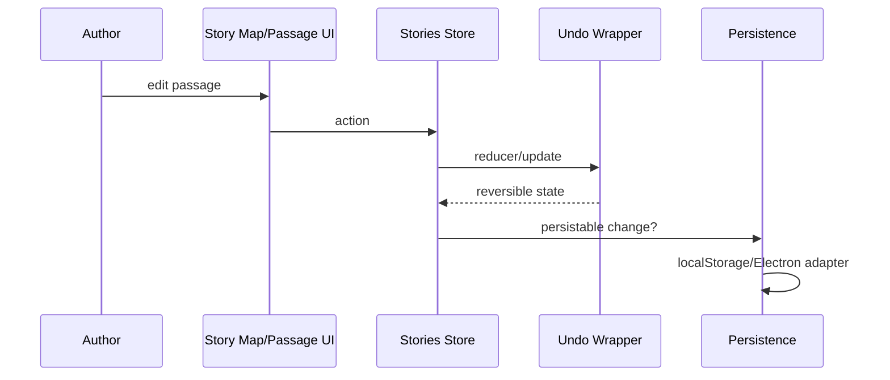
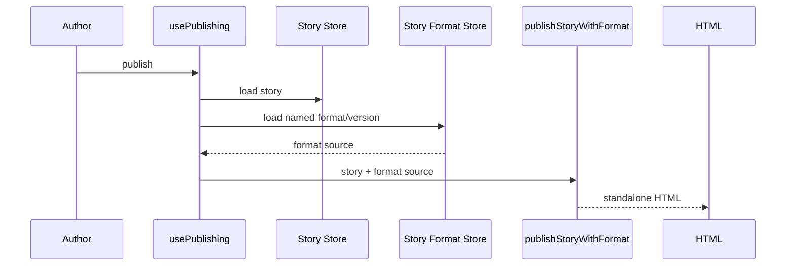
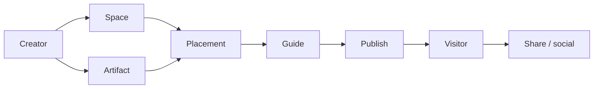

# 쓰기·읽기·저장·실패 흐름 비교

## 1. tldraw — local edit



### 실패 지점
- invalid record/schema
- migration incompatibility
- asset upload failure
- IDB/quota/storage failure

## 2. tldraw — multiplayer



### 명시된 fatal failure
권한/인증/버전/invalid record/rate limit/room capacity/message size 등.

---

# 3. Excalidraw — local edit



### 실패 지점
- localStorage quota
- IndexedDB file write error
- binary file missing
- history delta conflicts
- browser lifecycle before debounce flush

---

# 4. Excalidraw — collaboration



핵심: **realtime 전달과 durable 저장이 별개**.

---

# 5. H5P — author/save



### 실패 지점
- invalid package
- unsupported/missing library
- invalid semantics data
- whitelist violation
- dependency/version mismatch
- file storage error

---

# 6. H5P — runtime



---

# 7. Twine — authoring



### 특징
selected/highlighted 등은 persist filter에서 제외.

---

# 8. Twine — publish



### 실패 지점
- missing format
- incompatible/unloadable format
- malformed story/import
- browser local storage loss

---

# 9. Artsteps/Metasteps — product flow

확인 가능한 수준:



Metasteps 진화:

```text
Space
  + Portal graph
  + Info Points
  + multiple Guided Paths
  + Webviews
  + Membership/Roles
  + District
```

실제 save API, database write, scene serialization은 Unknown.
