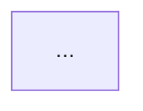

# 완전 구조 분석 템플릿

새 앱·웹·도구를 분석할 때 이 구조를 기본으로 사용한다.

# 0. 기본 정보
- 제품명
- 분석일
- 버전/commit
- 공식 사이트
- 공식 repository
- 라이선스
- 공개/비공개 범위

# 1. Product Boundary
- embeddable core
- hosted app
- server/service
- admin
- third-party dependencies

구조도:

# 2. Repository Topology
실제 source tree를 2~3 depth까지 조사.

- apps
- packages
- core
- server
- workers
- tests
- docs
- templates

각 폴더의 책임을 기록.

# 3. Dependency Architecture
- core dependency graph
- UI → domain → storage 방향
- circular dependency
- third-party infrastructure

# 4. Domain Model
핵심 entity/type:
- ID
- references
- parent/child
- immutable/mutable
- canonical source of truth

class diagram 작성.

# 5. State Taxonomy
모든 주요 상태를:
- canonical document
- editor session
- runtime session
- presence
- preference
- cache
- derived state
로 분류.

# 6. State Lifecycle / Destination Matrix

| State | browser | export | server | realtime | history | migration |
|---|---:|---:|---:|---:|---:|---:|

# 7. Command / Event Flow
사용자 action 하나가:
UI → command/action → domain/store → renderer → persistence
로 흐르는 경로 조사.

# 8. History / Undo
- snapshot / command / delta 방식
- redo invalidation
- remote update와 undo 관계
- transient action 처리

# 9. Persistence
- memory
- localStorage
- IndexedDB
- file
- server DB
- object storage
- autosave/debounce
- flush
- quota
- crash recovery
- tab conflict

# 10. Binary Asset Lifecycle
- upload
- metadata
- storage
- resolve
- cache
- garbage collection
- export
- deletion/orphan handling

# 11. Schema / Validation / Migration
- validator
- schema version
- migration sequence
- backwards compatibility
- unsupported version behavior

# 12. Realtime / Collaboration
- transport
- protocol
- authoritative state
- diff/reconciliation/CRDT 여부
- presence
- reconnect
- offline
- room/session
- rate limit
- message size

# 13. Auth / Permission
- authentication
- room/document access
- readonly
- role
- record/object-level permission
- sharing token/link

# 14. Authoring vs Runtime
- 저작 데이터
- 저작 UI
- 실행 data contract
- player/viewer
- publication

# 15. Extension Model
- plugin
- manifest
- custom type
- dependency
- version compatibility
- extension safety boundary

# 16. Import / Export / Sharing
- portable identity
- file structure
- package structure
- share link
- public/private
- embed

# 17. Error Taxonomy
오류를:
- validation
- storage
- network
- auth
- version
- quota
- missing asset
- malformed file
- collaboration conflict
로 분류.

# 18. Performance Architecture
- lazy loading
- caching
- debounce/throttle
- incremental diff
- worker
- asset resizing
- virtualized UI
- GPU considerations

# 19. Accessibility / Device
- keyboard
- screen reader
- touch
- coarse pointer
- responsive layout
- reduced motion
- low-spec fallback

# 20. Testing Topology
- unit
- integration
- E2E
- fixtures
- migration
- fuzz/property tests
- accessibility tests

# 21. Deployment / Operations
공개된 범위에서:
- frontend hosting
- server
- worker
- database
- object storage
- CDN/cache
- logging/analytics

확인 불가 영역은 Unknown.

# 22. Security / Privacy
- encryption
- secrets
- URL token
- E2EE
- user content
- data retention
- sandboxing
- arbitrary code

# 23. 장점
구조적 장점만 기록.

# 24. 단점 / Trade-off
장점의 반대급부까지 기록.

# 25. 재사용 패턴
우리 서비스와 상관없이 재사용 가능한 일반 원리.

# 26. Knol 적용
- ADOPT
- ADAPT
- ALREADY
- DEFER
- REJECT

# 27. Source Evidence Map
각 결론에:
- repository path
- official documentation
- version/date
를 연결.

# 28. Unknowns
알 수 없는 영역을 명시.

# 29. Confidence
- core code
- product behavior
- server infra
- operational behavior
각각 High/Medium/Low.

# 30. 다음 검증
브라우저 조작, network trace, import/export specimen, device test 등 후속 검증을 명시.

---

## 완료 기준

'완전 구조 분석'은 최소 다음이 있어야 한다.

- 실제 source tree
- 핵심 타입/데이터 모델
- 상태 생명주기
- read/write flow
- persistence
- history
- migration
- extension
- failure taxonomy
- security/permission
- source evidence
- unknowns

비공개 제품이라 이 중 확인 불가능한 항목은 **Unknown으로 남기는 것 자체가 완료 조건**이다.
